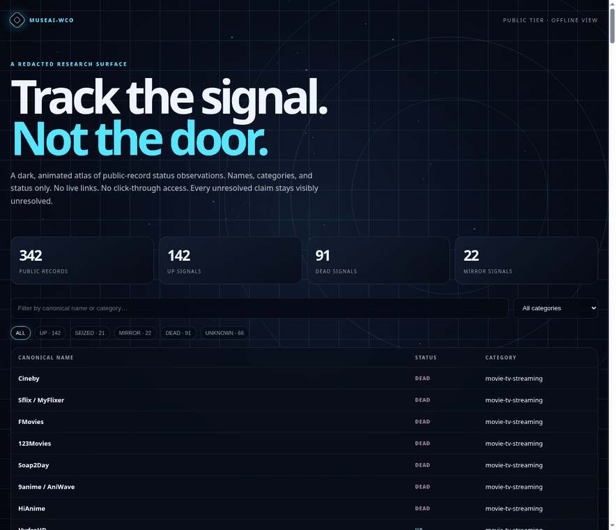
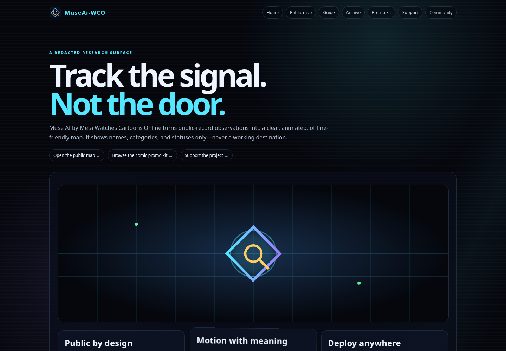
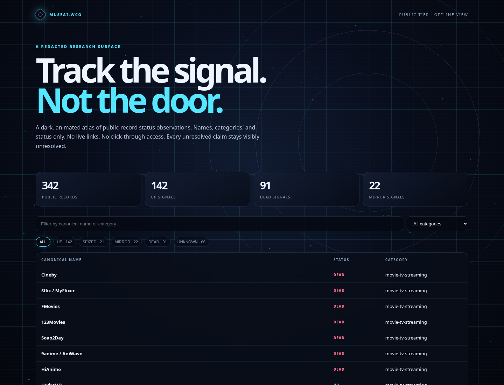

# Muse AI by Meta Watches Cartoons Online (MuseAi-WCO)


A redacted, offline-friendly research map for tracking public-record status observations without publishing working destinations.

> **Track the signal. Not the door.**

## Why this exists

Status research gets messy quickly. Names change, mirrors appear, takedowns are reported unevenly, and an unresolved claim can start looking like a fact once it is copied into a list. A conventional directory makes that problem worse by turning research into click-through access.

MuseAi-WCO keeps the useful part: canonical names, categories, status labels, enforcement tables, and a visible record of uncertainty. It intentionally leaves out live links, domains, private notes, redirects, and operational instructions.

The project is designed for researchers and maintainers who need a small, inspectable public surface while keeping detailed working notes in a separate tier.

## See it work

There is no hosted demo URL configured in this archive. The fastest real demo is the local public map:

```bash
python3 -m http.server 8000
```

Then open <http://localhost:8000/map/index.html>.

The map is a static HTML page. It renders an animated background, 342 embedded public rows, status counts, category filtering, and name/category search without a build step, CDN, external API, or network request to a tracked service.

<p align="center">
  
</p>

**Live workflow capture:** [`assets/demo/map-workflow.gif`](./assets/demo/map-workflow.gif)

## Screenshots

The images below are captured from the actual local application, not mockups.

<p align="center">
  
</p>

**Homepage screenshot:** [`assets/demo/homepage.png`](./assets/demo/homepage.png)

<p align="center">
  
</p>

**Public map screenshot:** [`assets/demo/public-map.png`](./assets/demo/public-map.png)

## Quick start

### Run the public map

```bash
python3 -m http.server 8000
# open http://localhost:8000/map/index.html
```

You can also open `map/index.html` directly in a browser. A local server is the more reliable option for navigating the full set of relative links.

### Regenerate the public tier

The public CSV is derived from the private working CSV by keeping only `name`, `status`, and `category`:

```bash
python3 scripts/redact-public.py
```

The map uses an embedded copy of the public rows so it also works from `file://` without CORS issues. Do not hand-edit `data/sites-public.csv`; regenerate it from the private tier instead.

### Run a safe local review

This command prints recorded statuses and never visits a site or follows a link:

```bash
python3 scripts/mirror-check.py
```

## What is included

- **Public map:** `map/index.html`, with search, category filtering, status pills, counts, and a redacted table.
- **Private research tier:** `data/sites-private.csv`, containing detailed working fields. Treat it as private.
- **Public data tier:** `data/sites-public.csv`, containing only canonical name, status, and category.
- **Enforcement data:** CSV tables for arrests, seizures, and takedowns under `data/enforcement/`.
- **Research notes:** methodology, mirror handling, redaction policy, rules, and source guidance under `docs/` and `sources/`.
- **Maintenance scripts:** local-only redaction, status review, and append-only rename observation helpers under `scripts/`.
- **Promo kit:** local SVG banners, illustrations, and looping GIFs under `assets/promo/`.

## Status legend

- **UP** — reported reachable or active in the supplied compilation; the map does not test it.
- **SEIZED** — a seizure or court/authority transfer is recorded.
- **MIRROR** — a successor, fallback, or mirror relationship is recorded.
- **DEAD** — the original operation is reported offline or ended.
- **UNKNOWN** — the status was not established or is conflicting.

The supplied public snapshot contains 342 rows: 142 `UP`, 91 `DEAD`, 66 `UNKNOWN`, 22 `MIRROR`, and 21 `SEIZED`.

## Data and safety boundaries

The public map shows names, categories, and statuses only. It does not fetch the private tier, visit tracked services, follow redirects, or expose operational details. Records retain `UNKNOWN` and `UNVERIFIED` labels where the source material did not establish a fact.

The repository contains `data/sites-private.csv` for research work. **Do not publish the repository root as-is.** Before using GitHub Pages, Cloudflare Pages, or another static host, remove the private file from the publish artifact or configure the host to exclude it. The included `.nojekyll`, `_headers`, and `_redirects` files are deployment helpers, not proof that the full repository is safe to expose.

## Project layout

```text
.
├── index.html                 # project landing page
├── map/index.html             # quickest working demo
├── data/
│   ├── sites-public.csv       # redacted public tier
│   ├── sites-private.csv      # private working tier; do not publish
│   └── enforcement/           # arrests, seizures, takedowns
├── docs/                      # method, rules, mirror, and redaction notes
├── scripts/                   # local maintenance helpers
├── assets/demo/               # real screenshots and map workflow GIF
└── assets/promo/              # local promotional artwork and animations
```

## Contributing

Keep records append-oriented and source-aware. Preserve uncertainty instead of upgrading it. Never add live destinations, private notes, personal details, redirects, or instructions for reaching an unauthorized service to the public tier.

For the local acceptance checklist, see [`tests/live-test-checklist.md`](tests/live-test-checklist.md).
